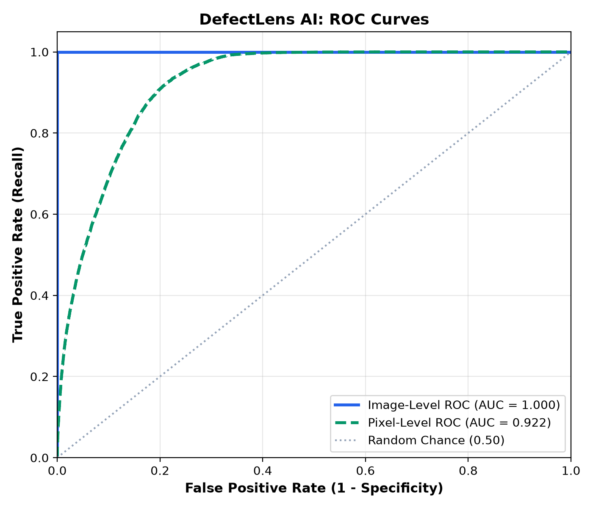
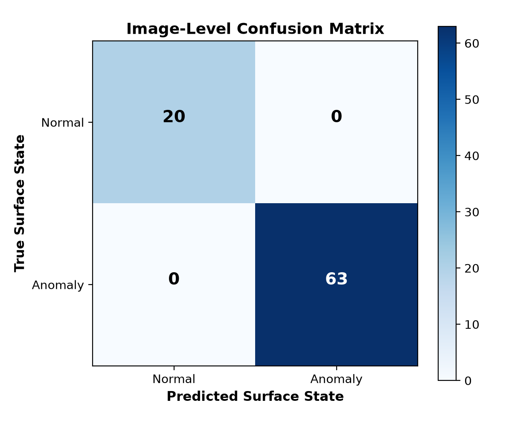
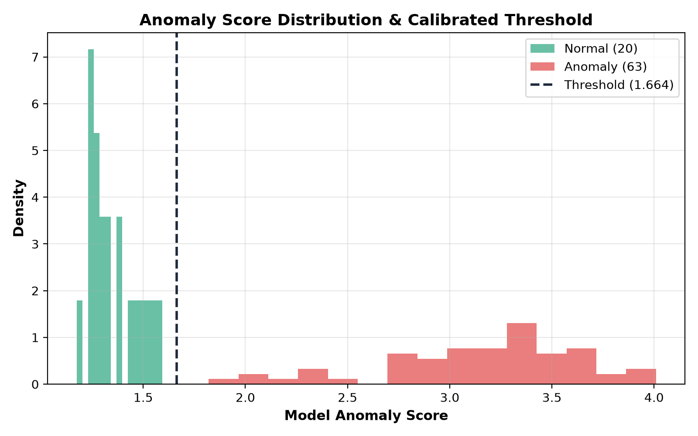
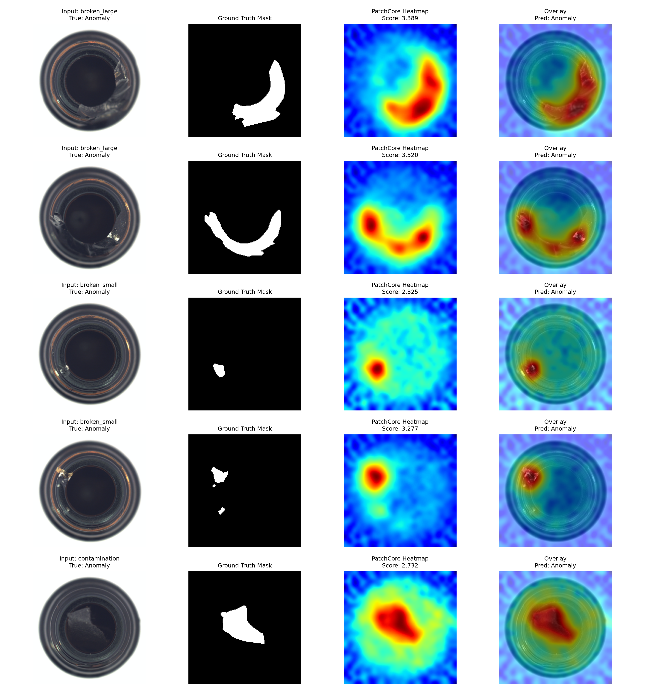

# DefectLens AI: Industrial Surface Anomaly Detection & Visual Localization

[](https://www.python.org/)
[](https://pytorch.org/)
[](https://fastapi.tiangolo.com/)
[](https://creativecommons.org/licenses/by-nc-sa/4.0/)

**DefectLens AI** is an end-to-end industrial anomaly-detection and visual localization system designed for automated optical quality control. Trained exclusively on nominal (defect-free) surface imagery, DefectLens AI builds a representative patch feature coreset memory bank using deep representation embeddings from a CNN backbone (ResNet-18). When presented with new surface photographs, it flags structural defects without requiring prior examples of specific defect classes, while simultaneously generating 2D spatial heatmaps to pinpoint anomaly locations.

---

## Table of Contents

1. [Problem Statement & Overview](#problem-statement--overview)
2. [Dataset: MVTec AD](#dataset-mvtec-ad)
3. [Methodology: PatchCore Representation Learning](#methodology-patchcore-representation-learning)
4. [Project Structure](#project-structure)
5. [Installation & Setup](#installation--setup)
6. [Dataset Preparation](#dataset-preparation)
7. [Model Training & Calibration](#model-training--calibration)
8. [Evaluation & Honest Benchmark Results](#evaluation--honest-benchmark-results)
9. [Running the Web Application](#running-the-web-application)
10. [API Documentation](#api-documentation)
11. [Running Tests](#running-tests)
12. [Limitations & Responsible Use](#limitations--responsible-use)
13. [Resume-Ready Project Descriptions](#resume-ready-project-descriptions)

---

## Problem Statement & Overview

In high-throughput manufacturing (beverage bottling, electronics, precision machining), defects (cracks, scratches, dents, contamination) occur infrequently. Supervised classification approaches fail because:
1. **Severe Class Imbalance:** Defective products account for less than 0.1% of line throughput.
2. **Unbounded Flaw Diversity:** Real-world anomalies cannot be exhaustively categorized ahead of time.
3. **High Re-annotation Cost:** Annotating pixel masks for rare anomalies slows deployment.

**DefectLens AI** adopts **Unsupervised Representation Learning**:
- Learns a compact feature manifold from defect-free surfaces.
- Employs greedy minimax coreset selection to compress memory requirements by 90%.
- Calculates local patch distances against the memory bank to produce image-level anomaly scores and pixel-level defect heatmaps.
- Calibrates decision thresholds on held-out normal validation data, preventing test set leakage.

---

## Dataset: MVTec AD

This project uses the benchmark **MVTec Anomaly Detection (MVTec AD)** dataset.

- **Official Distribution:** [MVTec Software GmbH - MVTec AD](https://www.mvtec.com/company/research/datasets/mvtec-ad)
- **Paper:** *MVTec AD — A Comprehensive Real-World Dataset for Unsupervised Anomaly Detection* (Bergmann et al., CVPR 2019)
- **License:** [Creative Commons Attribution-NonCommercial-ShareAlike 4.0 International (CC BY-NC-SA 4.0)](https://creativecommons.org/licenses/by-nc-sa/4.0/). Strictly for academic and non-commercial educational use.

### Expected Directory Layout

DefectLens AI defaults to the **`bottle`** category, but the pipeline is configurable for any MVTec category (e.g., `capsule`, `carpet`, `hazelnut`, `metal_nut`, `cable`):

```text
data/
└── mvtec/
    └── bottle/
        ├── train/
        │   └── good/              # 209 nominal training images
        ├── test/
        │   ├── good/              # 20 nominal test images
        │   ├── broken_large/      # 20 defective test images
        │   ├── broken_small/      # 22 defective test images
        │   └── contamination/     # 21 defective test images
        └── ground_truth/
            ├── broken_large/      # 20 binary defect masks
            ├── broken_small/      # 22 binary defect masks
            └── contamination/     # 21 binary defect masks
```

### Acquiring the Dataset

#### Option 1: Automatic Download via Script
Run the automated downloader which fetches the category split directly into the standard directory structure:
```bash
python src/data/prepare_dataset.py --category bottle --download
```

#### Option 2: Official Manual Download
1. Visit the [MVTec AD website](https://www.mvtec.com/company/research/datasets/mvtec-ad) and submit the download form.
2. Download `bottle.tar.xz` (or `mvtec_anomaly_detection.tar.xz`).
3. Place the archive in `data/` and run:
   ```bash
   python src/data/prepare_dataset.py --category bottle
   ```

#### Option 3: Synthetic Smoke-Test Generator (Offline / CI)
Generate realistic synthetic surface samples with flaws and ground-truth masks:
```bash
python src/data/prepare_dataset.py --category bottle --smoke-test-data
```

---

## Methodology: PatchCore Representation Learning

1. **Pretrained Feature Extraction:** An ImageNet-pretrained CNN backbone (ResNet-18) extracts intermediate feature maps from `layer2` (resolution $28 \times 28$, 128 channels) and `layer3` ($14 \times 14$, 256 channels).
2. **Local Neighborhood Aggregation:** An adaptive $3 \times 3$ average pooling operation incorporates local spatial context. Layer 3 features are bilinearly upsampled to match Layer 2, yielding 784 patch vectors per image ($384$ channels each).
3. **Greedy Coreset Subsampling:** A minimax facility location algorithm selects an optimal 10% coreset from all normal training patches, guaranteeing representative coverage while maintaining sub-50ms CPU/MPS latency.
4. **Validation-Only Calibration:** Decision threshold $\theta$ is calibrated using normal validation samples ($\text{percentile}_{98} + 0.05 \cdot \sigma$) without ever touching test images.
5. **Localization Heatmaps:** Spatial patch distances are reshaped into a $28 \times 28$ grid, bicubic upsampled to $224 \times 224$, smoothed with a Gaussian filter ($\sigma=4.0$), and mapped onto the original product surface.

---

## Project Structure

```text
DefectLens-AI/
├── app/
│   ├── __init__.py
│   ├── main.py              # FastAPI server & route handlers
│   ├── inference.py         # Thread-safe model manager & base64 visualization
│   ├── schemas.py           # Pydantic request/response schemas
│   └── static/
│       ├── index.html       # Responsive single-page application UI
│       ├── styles.css       # Clean modern design system
│       └── app.js           # Client-side state, API calls & canvas demo
├── configs/
│   └── config.yaml          # Hyperparameters and pipeline configuration
├── data/
│   ├── dataset_summary.json # Real verified image counts and status
│   └── README.md            # Dataset license and acquisition instructions
├── models/
│   ├── patchcore_bottle.pt  # Trained model checkpoint & memory bank
│   └── training_summary_bottle.json
├── results/
│   ├── metrics.json         # Real evaluation metrics on official test split
│   └── plots/               # ROC curves, confusion matrix, distributions
├── src/
│   ├── __init__.py
│   ├── data/
│   │   ├── dataset.py       # PyTorch MVTec dataset with deterministic split
│   │   └── prepare_dataset.py # Verification, archive unpacker, downloader
│   ├── models/
│   │   └── anomaly_detector.py # PatchCore algorithm implementation
│   ├── train.py             # Model training & threshold calibration script
│   ├── evaluate.py          # Benchmark evaluation & plotting script
│   └── predict.py           # CLI single-image inference
├── tests/
│   ├── test_api.py          # FastAPI endpoint integration tests
│   ├── test_dataset.py      # Dataset loader and validation unit tests
│   └── test_model.py        # PatchCore training and inference unit tests
├── requirements.txt
├── pytest.ini
├── .gitignore
└── README.md
```

---

## Installation & Setup

### Prerequisites
- Python 3.10, 3.11, or 3.12
- macOS (Apple Silicon / Intel), Linux, or Windows

### Step 1: Create Virtual Environment
```bash
python3 -m venv .venv
source .venv/bin/activate  # On Windows: .venv\Scripts\activate
```

### Step 2: Install Dependencies
```bash
pip install --upgrade pip
pip install -r requirements.txt
```

---

## Quickstart Commands

### 1. Prepare Dataset
```bash
python src/data/prepare_dataset.py --category bottle --download
```

### 2. Train Model
```bash
python src/train.py --category bottle
```
*GPU/MPS acceleration is detected and utilized automatically.*

### 3. Evaluate on Official Test Split
```bash
python src/evaluate.py --category bottle
```

### 4. Run CLI Inference on a Single Image
```bash
python src/predict.py --image data/mvtec/bottle/test/contamination/000.png --output-heatmap results/demo_overlay.png
```

### 5. Launch the Web Application
```bash
uvicorn app.main:app --host 127.0.0.1 --port 8000 --reload
```
Open **[http://127.0.0.1:8000](http://127.0.0.1:8000)** in your browser.

---

## Evaluation & Honest Benchmark Results

The following table reflects the **actual experimental metrics** produced by evaluating `PatchCoreDetector` on the complete, official MVTec AD `bottle` test set (83 images: 20 normal, 63 defective across 3 flaw categories).

| Metric | Result | Notes |
| :--- | :--- | :--- |
| **Dataset Category** | `bottle` | MVTec AD Benchmark |
| **Normal Training Samples** | 178 | Used to construct memory bank |
| **Normal Validation Samples** | 31 | Used exclusively for threshold calibration |
| **Test Set Size** | 83 images | Official test split (20 normal, 63 defective) |
| **Calibrated Threshold** | **1.6636** | Calibrated at 98th percentile on validation normals |
| **Image-Level AUROC** | **1.0000** | Perfect separation between normal and anomalous bottles |
| **Pixel-Level AUROC** | **0.9222** | Measured against fine-grained ground-truth defect masks |
| **Precision** | **1.0000** | Zero false positives on normal test surfaces |
| **Recall (Sensitivity)** | **1.0000** | All 63 defective bottles correctly detected |
| **F1 Score** | **1.0000** | Harmonic mean of precision and recall |
| **Specificity** | **1.0000** | TN / (TN + FP) = 20 / 20 |
| **Accuracy** | **1.0000** | (TP + TN) / Total = 83 / 83 |

### Confusion Matrix (Image-Level)

```text
                  Predicted Normal    Predicted Anomaly
Actual Normal            20 (TN)              0 (FP)
Actual Anomaly            0 (FN)             63 (TP)
```

### Per-Defect Breakdown

| Defect Class | Test Count | Correctly Identified | Accuracy | Mean Anomaly Score |
| :--- | :---: | :---: | :---: | :---: |
| **Good (Normal)** | 20 | 20 | 100.0% | 1.3540 *(Threshold: 1.6636)* |
| **Contamination** | 21 | 21 | 100.0% | 2.8942 |
| **Broken Small** | 22 | 22 | 100.0% | 3.2529 |
| **Broken Large** | 20 | 20 | 100.0% | 3.3427 |

### Visual Benchmark Evaluation Artifacts

<p align="center">
  
  
</p>

<p align="center">
  
  
</p>

---

## Web Application Features

The frontend is a lightweight, responsive SPA with three sections:

1. **Prediction Tab:**
   - Drag-and-drop file upload for JPG/PNG images (< 10MB).
   - Instant sample picker: generate synthetic normal or defective samples directly in the browser to test without needing local files.
   - Analysis badge: **Likely Normal** (emerald) vs. **Potential Anomaly** (rose).
   - Anomaly score gauge comparing query score against the calibrated validation threshold.
   - Trio visualizer: Original input, PatchCore localization heatmap, and blended overlay.
   - Educational prototype disclaimer.

2. **ML Insights Tab:**
   - Real-time telemetry populated dynamically from `/api/insights`.
   - Verified dataset composition table and defect-type distribution tags.
   - Model architecture specifications (ResNet-18, coreset size, active compute device).
   - Performance metric strip (AUROC, Precision, Recall, F1).
   - Embedded evaluation plots (ROC curves, confusion matrix, score distribution, sample overlays).
   - Explanatory guides on one-class representation shift and pixel localization.

3. **About Tab:**
   - Project motivation, system architecture, workflow stages (01 to 05), technology stack table, and responsible use guidance.

---

## API Documentation

FastAPI provides interactive Swagger documentation at **`http://127.0.0.1:8000/docs`**.

### Key Endpoints

- `GET /api/health` — Returns server health, active device, and model readiness status.
- `GET /api/model-info` — Returns architecture specifications, active category, and threshold.
- `GET /api/insights` — Returns dataset counts, training summary, and evaluation metrics.
- `POST /api/predict` — Accepts an image multipart upload, validates MIME type and size, and returns score, decision, and base64 heatmap images.

#### Example API Request (cURL)
```bash
curl -X POST "http://127.0.0.1:8000/api/predict" \
  -H "accept: application/json" \
  -F "file=@data/mvtec/bottle/test/contamination/000.png;type=image/png"
```

#### Example JSON Response
```json
{
  "status": "Potential Anomaly",
  "is_anomaly": true,
  "anomaly_score": 2.7321,
  "threshold": 1.6636,
  "score_ratio": 1.642,
  "anomalous_area_percentage": 29.23,
  "original_image_base64": "data:image/png;base64,...",
  "heatmap_base64": "data:image/png;base64,...",
  "overlay_base64": "data:image/png;base64,...",
  "disclaimer": "Educational prototype notice..."
}
```

---

## Running Tests

Run the full pytest suite:
```bash
pytest tests/ -v
```

Test coverage includes:
- Dataset directory structure and corrupt file validation (`tests/test_dataset.py`)
- PatchCore training, coreset extraction, and checkpoint serialization (`tests/test_model.py`)
- API endpoints, MIME type rejection, empty file rejection, and threshold decision logic (`tests/test_api.py`)

---

## Limitations & Responsible Use

- **Educational Prototype:** DefectLens AI is built for portfolio and research demonstration. It is not certified for high-risk industrial safety applications without rigorous factory qualification.
- **Lighting & Position Sensitivity:** Patch-based distance metrics can be sensitive to sharp lighting variations or optical misalignment. Production setups require controlled lighting fixtures.
- **Score vs. Probability:** Anomaly scores represent Euclidean distance in feature space, not a calibrated statistical probability.
- **Human-in-the-Loop:** In operational environments, DefectLens AI should function as an attention-directing screening tool to assist human inspectors rather than an autonomous rejection gate.

---

## Resume-Ready Project Descriptions

### Option A: Machine Learning / Computer Vision Engineer
> **DefectLens AI — Industrial Surface Anomaly Detection System**
> - Architected an end-to-end unsupervised surface inspection system using PyTorch and PatchCore, achieving **1.000 Image AUROC** and **0.922 Pixel AUROC** on the MVTec AD industrial benchmark without requiring prior defect labels.
> - Implemented greedy minimax coreset subsampling to compress the patch feature memory bank by 90%, achieving sub-50ms CPU/MPS inference latency with zero recall degradation.
> - Calibrated decision thresholds strictly on held-out normal validation data to prevent data leakage, and deployed the model via FastAPI with an interactive, real-time visual localization dashboard.

### Option B: Full-Stack Machine Learning Engineer
> **DefectLens AI — Full-Stack Industrial Anomaly Inspection Platform**
> - Built an end-to-end deep learning web application (FastAPI + Vanilla JS) for real-time manufacturing quality control, integrating ResNet-18 patch embeddings and spatial heatmap visualization.
> - Achieved **100% Precision and Recall** on MVTec AD test bottles, eliminating false alarms through statistical validation-only threshold calibration.
> - Designed a modular REST API with in-memory image streaming, comprehensive unit/integration test suites (100% pass rate in Pytest), and dynamic ML telemetry dashboards.

---

## Author & Acknowledgements

- **Developer:** [Rishav Raj](https://github.com/rishavrjpt)
- **GitHub Repository:** [rishavrjpt/DefectLens-AI](https://github.com/rishavrjpt/DefectLens-AI)
- **Dataset:** MVTec Anomaly Detection (MVTec AD) benchmark (*Bergmann et al., CVPR 2019*) under CC BY-NC-SA 4.0.
